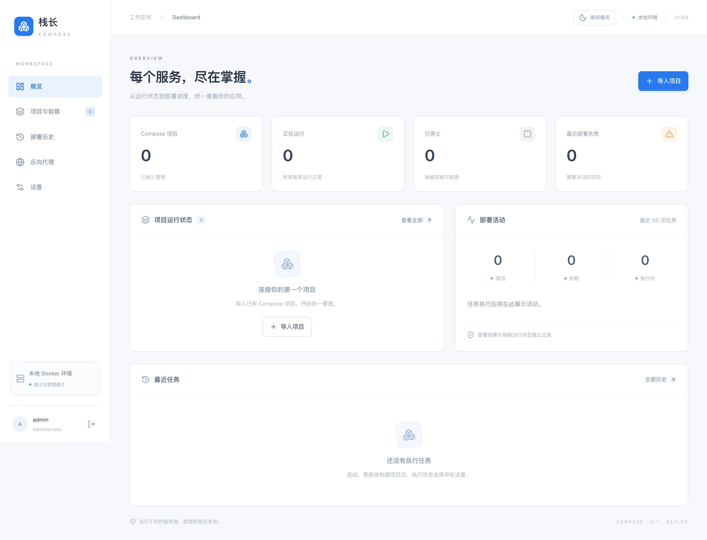
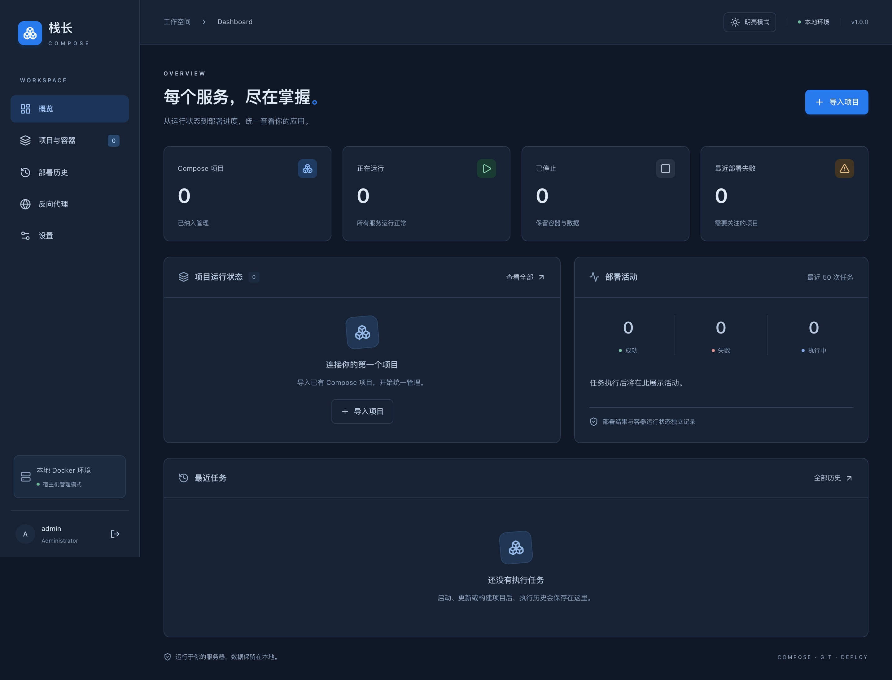
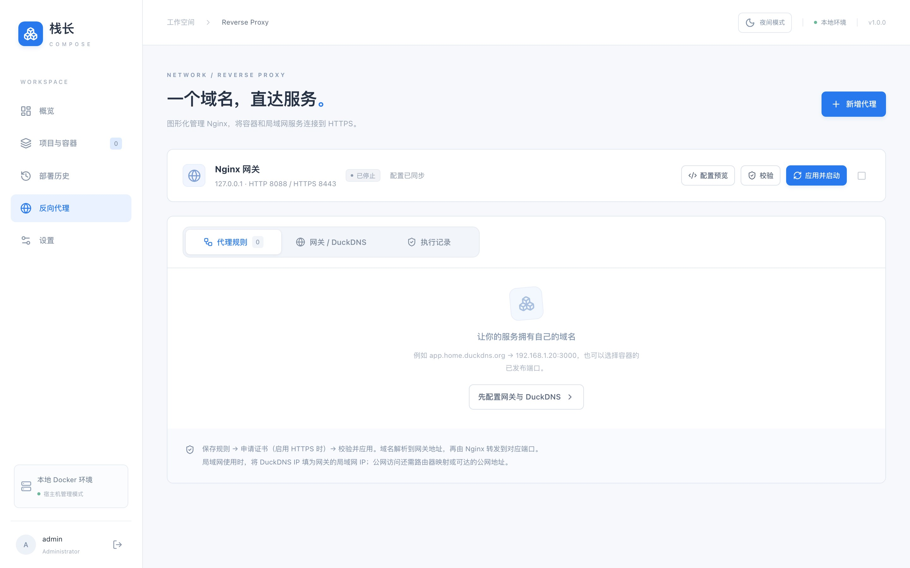
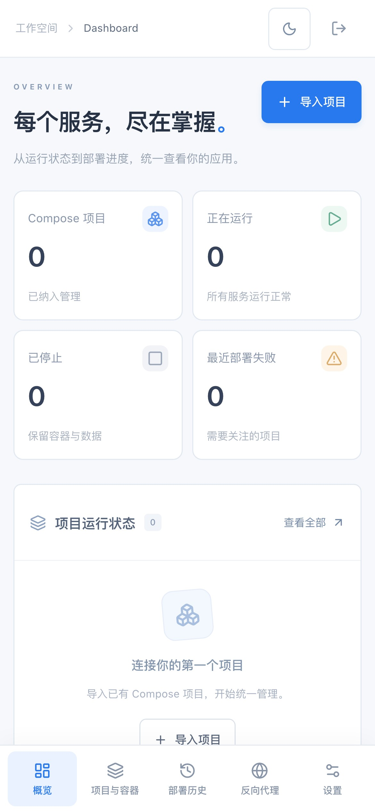
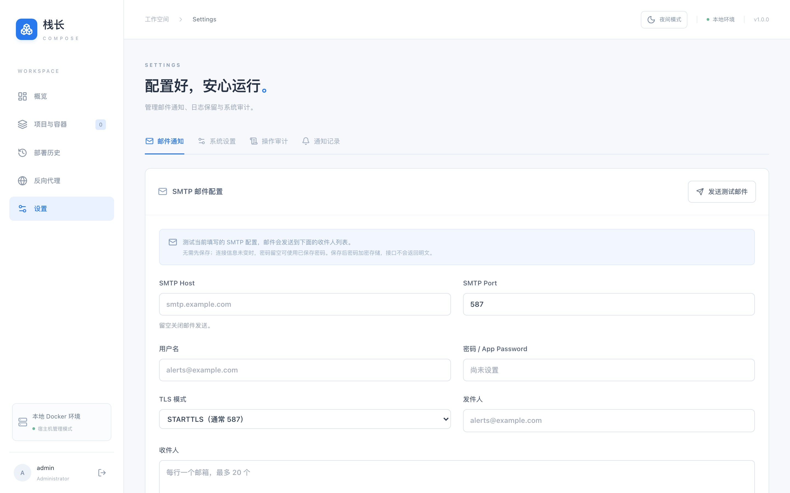

<div align="center">

# 栈长

**一个二进制，看管你的每一个栈。**

轻量级 Docker Compose 管理与 Git 自动部署平台


</div>

---

栈长跑在你的 Linux 服务器上，用宿主机的 Docker Compose 和 Git 管项目：导入已有的 compose 文件、查看服务与容器状态、拉取代码并部署、回看每一次任务的完整日志。

它不引入 Kubernetes，不需要外部数据库，也不需要 Nginx 或常驻的 Node 进程——生产环境只有一个内嵌前端的 Go 二进制。



## 特性

**项目与容器**

- 自动发现宿主机上的 Compose 项目，也可手动指定目录或 compose 文件
- 服务器目录/文件选择器，支持隐藏目录、粘贴路径、多文件按序绑定
- Stack / Service / Container 三级状态，逐个启停重启
- 只读导入：校验路径与配置，不改动你的项目

**Git 与部署**

- 检查更新、仅拉取代码、拉取并部署、按当前代码重新构建
- 拒绝脏工作区，只做 `merge --ff-only`，不执行 `reset --hard`
- 分别记录远程、本地、最近尝试与最近成功的 Commit，失败不会误记成功
- 按项目轮询自动部署，失败后 5/15 分钟退避重试，达到阈值暂停

**任务与日志**

- SQLite 持久化任务队列，默认全局串行，项目与 Git 工作区互斥
- 支持取消、超时，进程重启后恢复被中断的任务
- 任务日志持久化，SSE 流式输出，支持游标续读与完整下载
- 容器最近 N 行日志，过期自动清理

**安全**

- Argon2id 密码哈希、HttpOnly / SameSite Cookie、CSRF 校验、登录限流
- 首次登录强制改密，改密后旧会话全部失效
- 操作审计与通知记录
- Git / Docker 通过固定参数数组执行，不提供任意 Shell 接口

**反向代理**

- 图形化管理 Nginx：域名指向容器端口或局域网服务，支持 WebSocket 与 HTTPS 跳转
- DuckDNS 动态 IP 更新，Let's Encrypt DNS-01 证书签发与自动续期
- 配置先校验再应用，启动失败尝试恢复旧配置

## 界面

<p align="center">  
    
    
</p>

<p align="center">  
    
    
</p>

明暗主题可在右上角切换，从点击位置圆形扩散到整页；系统开启「减少动态效果」时自动简化。手机端使用底部滑动导航，表格在窄屏下变为卡片。

## 快速开始

环境要求：Go 1.26+、Node.js 24+、Docker Engine + Compose Plugin（需支持 `up --wait` 与 `--pull`）、Git。不需要 C 编译器。

### 构建单文件

```sh
nvm use
cd frontend && npm ci && cd ..
./scripts/build.sh
./bin/zhan
```

脚本会安装前端锁定依赖、生成生产页面、同步 embed 资源，并以 `CGO_ENABLED=0` 编译出单个二进制。

访问 <http://127.0.0.1:12345，使用> `admin / 123456` 登录，首次登录必须设置新密码。

生产部署、SSH 凭据、备份、HTTPS 与 systemd 配置见 [安装文档](docs/install.md)。

### 本地开发

```sh
# 终端一：后端
make dev-backend

# 终端二：前端
cd frontend && npm run dev
```

前端访问 <http://127.0.0.1:5173，Vite> 代理 `/api` 到 `127.0.0.1:12345`。开发启动固定使用仓库根目录的 `data/`，可通过 `ZHAN_DATA_DIR` 指定其他目录，例如 `ZHAN_DATA_DIR="$PWD/data-dev" make dev-backend`。同一数据目录同时只能运行一个实例。

### Docker

```sh
./scripts/docker-up.sh
# 或 make docker-up
```

镜像内含前后端、Docker Compose 与 Git，挂载宿主机 Docker socket 后可管理已有业务容器。详见 [Docker 部署说明](docs/docker.md)。

## 配置

配置文件示例见 [configs/config.example.yaml](configs/config.example.yaml)，也可用环境变量覆盖：

| 配置项                    | 环境变量                 | 默认值               | 说明                       |
| ---------------------- | -------------------- | ----------------- | ------------------------ |
| `listen`               | `ZHAN_LISTEN`        | `127.0.0.1:12345` | 监听地址                     |
| `data_dir`             | `ZHAN_DATA_DIR`      | `data`            | 数据目录，含 `zhan.db`、日志与代理配置 |
| `allowed_roots`        | `ZHAN_ALLOWED_ROOTS` | 空                 | 限定可访问的服务器目录，留空表示不限       |
| `secure_cookies`       | —                    | `false`           | 通过 HTTPS 访问时设为 `true`    |
| `session_hours`        | —                    | `12`              | 会话有效期                    |
| `workers`              | —                    | `1`               | 并发任务数，默认全局串行             |
| `task_timeout_minutes` | —                    | `30`              | 单个任务超时                   |
| `log_retention_days`   | —                    | `30`              | 任务日志保留天数                 |
| `max_log_mb`           | —                    | `20`              | 单个任务日志上限                 |
| `retry_delays_seconds` | —                    | `[300, 900]`      | 失败后重试间隔                  |

`allowed_roots` 使用系统路径分隔符（Linux / macOS 为冒号）。`.env` 不会自动加载。

## 命令语义

| 操作    | 行为                                                                   |
| ----- | -------------------------------------------------------------------- |
| 检查更新  | 查询本地版本和 `git ls-remote`，不修改工作区                                       |
| 拉取代码  | 干净工作区中 fetch + merge --ff-only，不部署                                   |
| 拉取并部署 | 更新 Git，按服务构建或拉取镜像，`up --no-build --pull never`，最多等待 120 秒验证容器运行与健康状态 |
| 重新构建  | 使用当前本地代码，随后部署，不拉取 Git                                                |
| 启动    | `up -d --no-build --pull never`，不主动拉取 Git、镜像或构建                      |
| 停止    | `compose stop`，不执行 `down`，不删除容器或数据卷                                  |

所有 Compose 命令明确指定 `-p`、`--project-directory` 和每个 `-f`。服务启动使用 `--no-deps`，依赖未运行时拒绝执行；容器操作会核对其所属 Stack。

手动停止整个项目会持久化 `desired_state=stopped`：Git 仍可检查和手动拉取，但自动部署不会启动服务。手动「部署并启动」需要显式勾选确认。

Git 绑定使用现有的 `origin` 与当前分支。推荐为服务账户配置最小权限 SSH Deploy Key：界面上传私钥、跳过 SSH 主机校验、`reset --hard` 这些能力都没有提供。

## HTTP API

统一前缀 `/api/v1`。登录后取得 `csrf_token`，写请求需带 `X-CSRF-Token` 与会话 Cookie。

| 分组   | 端点                                                                                                    |
| ---- | ----------------------------------------------------------------------------------------------------- |
| 认证   | `POST /auth/login`、`POST /auth/logout`、`GET /auth/me`、`GET /auth/status`、`POST /auth/password`        |
| 项目   | `GET /stacks`、`GET /stacks/discover`、`POST /stacks/import`、`GET/PUT /stacks/:id`                      |
| 操作   | `POST /stacks/:id/{start,stop,restart,rebuild,deploy}`                                                |
| 服务   | `GET /stacks/:id/services`、`POST /stacks/:id/services/:name/{start,stop,restart}`                     |
| 容器   | `POST /stacks/:id/containers/:container/{start,stop,restart}`                                         |
| 日志   | `GET /stacks/:id/logs`、`/services/:name/logs`、`/containers/:container/logs`，支持 `tail=200`             |
| Git  | `POST /stacks/:id/git/{check,pull}`、`GET /stacks/:id/git/status`、`PUT /stacks/:id/polling`            |
| 任务   | `GET /tasks`、`GET /tasks/:id`、`POST /tasks/:id/{retry,cancel}`                                        |
| 任务输出 | `GET /tasks/:id/logs`、`GET /tasks/:id/logs?download=1`、`GET /tasks/:id/stream`                        |
| 设置   | `GET/PUT /settings`、`PUT /settings/smtp`、`POST /settings/smtp/test`、`GET /audit`、`GET /notifications` |
| 目录浏览 | `GET /filesystem?path=/opt/projects&offset=0&limit=200&hidden=0`                                      |

长操作返回 `202 {"data":{"id":...}}`，读取返回 `{"data":...}`，失败为 `{"error":"..."}`。任务 SSE 支持 `Last-Event-ID` / `offset` 续读，未指定时从日志末尾最多 64 KiB 开始；会话失效后断开日志流。

## 项目结构

```text
backend/cmd/server/             程序入口、管理员初始化、进程锁
backend/internal/auth/          密码、Session、凭据加密
backend/internal/database/      SQLite 存储与版本化迁移
backend/internal/docker/        路径校验、项目发现、Compose 固定命令
backend/internal/deploy/        Git、队列、调度、任务与日志
backend/internal/notify/        SMTP 与去重
backend/internal/proxy/         受管 Nginx、DuckDNS、ACME 证书
backend/internal/httpapi/       REST / SSE 与鉴权
backend/internal/webui/         嵌入的前端构建资源
frontend/src/                   概览、项目、部署、设置页面
scripts/                        构建与校验
configs/                        YAML 与 systemd 示例
```

## 测试

```sh
./scripts/check.sh

# 并发检查
cd backend && go test -race ./...
```

覆盖范围包括本地临时 Git 远程仓库、脏工作区保护、Commit 记账、失败构建不部署、停止期望状态、有限重试、任务取消互斥、SQLite 持久化恢复、路径与符号链接边界、认证与 CSRF、只读导入、SSE 与日志下载、SMTP 加密去重。自动测试使用模拟 Docker，不会操作现有业务项目。

需要真实 Docker 的端到端验证只创建一个随机命名、无公开端口、无宿主机挂载的临时 Nginx 项目，结束后仅清理该测试项目（需预先准备 `nginx:stable-alpine` 镜像）：

```sh
cd backend
ZHAN_DOCKER_INTEGRATION=1 go test -v ./internal/deploy -run TestRealDockerLifecycle
```

## 文档

- [安装与 systemd](docs/install.md)
- [Docker 部署](docs/docker.md)
- [反向代理使用说明](docs/reverse-proxy.md)

## 边界

V1 不承诺自动回滚或零停机部署。部署阶段失败可能已经影响旧服务，构建失败会阻止后续部署。内存占用目标尚待在目标 Linux 服务器上实测，不能当作已验证结果。

仅将可信项目纳入自动构建：管理平台通过 Docker socket 与宿主机文件系统工作，本身就具有很高的权限。
